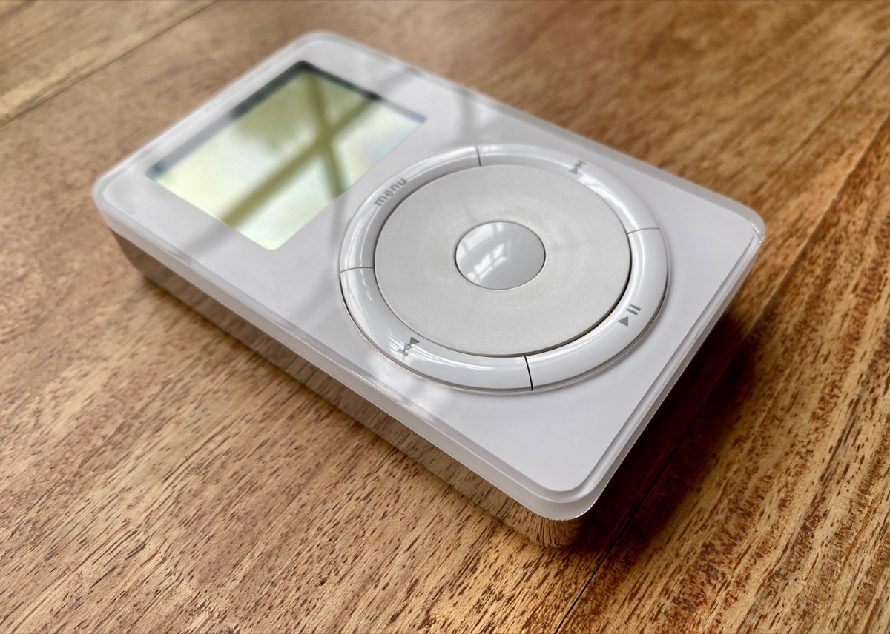
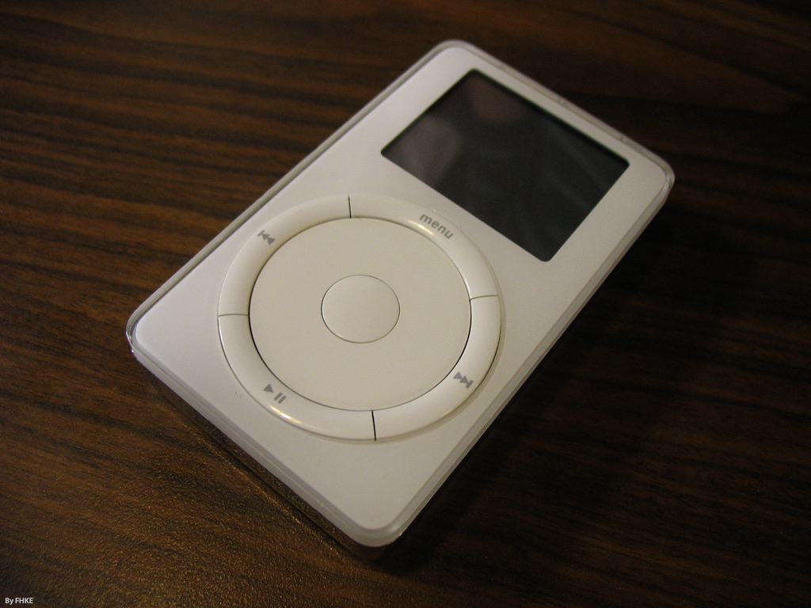

# mPod

A pocket music player for your own music, as an installable web app. The code is private.

## A love letter to the iPod

Apple released the first iPod on 10 November 2001. mPod’s first public release, v0.1.0, marks its 25th anniversary on 10 November 2026. This is an homage to the first and second generation iPod, made as a work of love.

The wheel turns beneath your hand, each step gives its tick, and the buttons press like switches. The grey LCD and its backlight complete the small, familiar world we wanted to honour.

<p>
  
  
</p>

Photos: the first generation by [Blake Patterson](https://commons.wikimedia.org/wiki/File:Original_iPod_5G_(52066067732).jpg), [CC BY 2.0](https://creativecommons.org/licenses/by/2.0); the second generation by [fhke](https://commons.wikimedia.org/wiki/File:IPod_second_generation-2007-07-29.jpg), [CC BY-SA 2.0](https://creativecommons.org/licenses/by-sa/2.0). Both from Wikimedia Commons, resized.

mPod plays your own music from folders on your own device, offline, in an app you install from the web. Every line of code is our own, written from our own descriptions of how the iPod behaved. Made by Alexander Somma with Sage.is AI.

mPod is an unofficial fan project. It is not affiliated with or endorsed by Apple Inc. iPod is a trademark of Apple Inc.

## Run it

```bash
python3 -m http.server 8080
```

Then open `http://127.0.0.1:8080/`. Folder access, the service worker and install need HTTPS or localhost.

`make publish` rebuilds the generated files, runs the checks, writes `dist/` and copies it to the tailnet page. `make deploy` does the same for Cloudflare Pages. `dist/` is plain static files, so any host can serve it. `node dev/draw-icons.mjs` redraws the icons.

## Layout

- `index.html`, `manifest.webmanifest`, `sw.js`, `sw-precache.js`, `icons/`: the page people open and what installs it.
- `src/`: the `pod-player` web component. Plain ES modules, no build step, no dependencies.
- `dev/`: dev server, test page, and a small Chrome client.
- `docs/spec/`: the specification this code is built from.
- `docs/SPEC-GAPS.md`, `docs/SPEC-GAPS-00-31.md`: where the spec was silent or wrong, and what was chosen.
- `fonts/`: our own drawn pixel font and its builder.
- `fixtures/`: an invented catalogue and test tones.
- `tests/`: browser and unit suites. See `tests/README.md`.

## Release status

Alexander accepted the risk on 2026-11-01. The font, the CSS overlap, the name and the look ship as they are, and a complaint means taking the site down. `src/pod-screen.ttf` is ChicagoFLF 2.1: see `docs/FONT.md`.

Test specifications and comparison tools live in the private `Sage-is/Pod-Recomp` repo.
